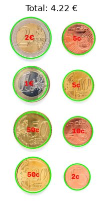
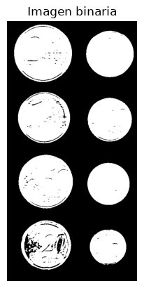
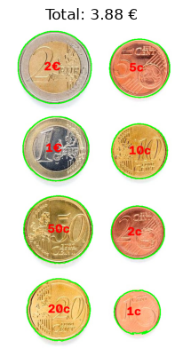
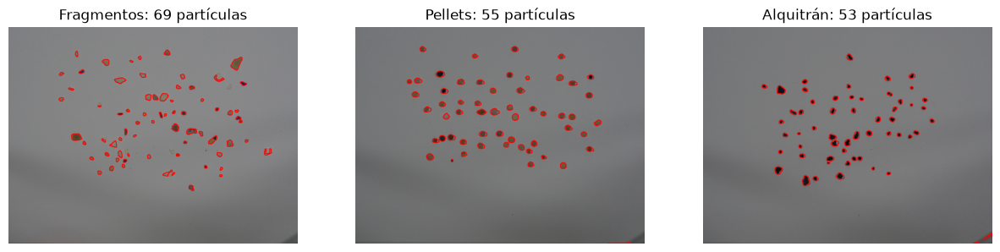
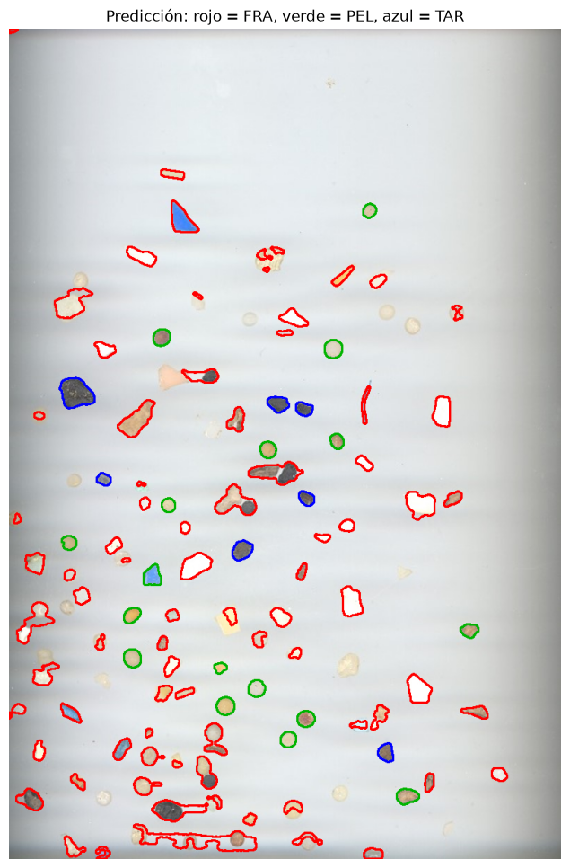
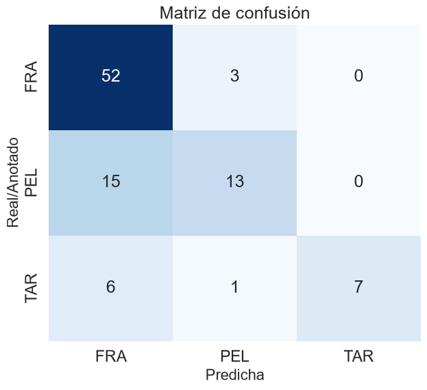

## Práctica 3. Detección y reconocimiento de formas

## Descripción

El objetivo es extraer información geométrica y de apariencia de los objetos de una imagen para caracterizarlos y clasificarlos de forma automática. En ninguna de las tareas se usan modelos de aprendizaje profundo.

La práctica se divide en dos tareas:

* **Tarea 1:** contar el dinero presente en una imagen de monedas y en un demostrador en vivo con la webcam.
* **Tarea 2:** segmentar las partículas de una imagen y clasificarlas en fragmentos, *pellets* o alquitrán, evaluando el resultado con una matriz de confusión.

| Tarea | Notebook |
|-------|----------|
| Tarea 1 | [`TAREAS/VC_P3_TAREA_1.ipynb`](TAREAS/VC_P3_TAREA_1.ipynb) |
| Tarea 2 | [`TAREAS/VC_P3_TAREA_2.ipynb`](TAREAS/VC_P3_TAREA_2.ipynb) |

El notebook [`VC_P3.ipynb`](VC_P3.ipynb) contiene los ejemplos de la práctica (umbralizado, contornos, transformada de Hough, características geométricas y métricas).

---

## Tarea 1 — Contar dinero en monedas

### Escala píxeles → milímetros

Solo con los píxeles no se puede saber qué moneda es cada una, porque su tamaño en la imagen depende de la distancia de la cámara. Por eso el usuario hace **clic sobre la moneda de 1 €**, cuyo diámetro real es 23.25 mm, y se obtiene la escala:

```
mm_por_px = 23.25 / diámetro_en_píxeles_de_la_moneda_de_1€
```

Con esa escala se pasa el diámetro de cada moneda a milímetros y se asigna la moneda oficial de diámetro más cercano (1c = 16.25 mm, 2c = 18.75, 10c = 19.75, 5c = 21.25, 20c = 22.25, 1 € = 23.25, 50c = 24.25, 2 € = 25.75). Al final se suma el valor de todas.

### Versión 1: transformada de Hough (no funciona bien)

Primero se localizaron las monedas con `cv2.HoughCircles`, tomando el radio de cada círculo como medida. El radio que devuelve Hough no es lo bastante preciso: las monedas de tamaño parecido (por ejemplo 20c y 50c, o 1c y 2c) se separan solo por 1 mm, y un error de pocos píxeles las confunde. El total obtenido fue **4.22 €** cuando el correcto es **3.88 €**.

 

### Versión 2: medir con el contorno (funciona bien)

Se sustituye Hough por umbralizado y contornos:

1. Se pasa a grises, se suaviza con un filtro Gaussiano y se umbraliza con **Otsu** invertido (monedas en blanco, fondo en negro).
2. Se buscan los **contornos externos** y se descartan los pequeños.
3. El diámetro se calcula a partir del **área** del contorno, que es mucho más estable que el radio de Hough:

```
área = π · (d/2)²   →   d = 2 · √(área / π)
```

Con este cambio se clasifican bien las 8 monedas y el total es **3.88 €**.

 

### Demostrador en vivo con la webcam

Se aplica el mismo método a cada fotograma de la cámara:

* Se umbraliza con Otsu y se aplica un **cierre morfológico** para tapar los reflejos de las monedas.
* Se hace clic en la moneda de 1 € para calibrar la escala. Con la tecla **R** se recalibra y con **ESC** se sale.
* Para cada contorno se calcula la **circularidad** (4πA/P²). Si es menor que 0.80, no es redondo: será un objeto que no es moneda o monedas solapadas, y se marca con `?` en gris.
* Si es redondo pero su diámetro se aleja más de 0.7 mm de todas las monedas oficiales, se marca como **"no moneda"** en rojo.
* El resto se etiqueta en verde y su valor se suma al total que aparece en pantalla.

Limitaciones del demostrador:

* El fondo debe ser claro y uniforme para que Otsu separe bien las monedas. Con sombras o reflejos fuertes el contorno se deforma y cambia el diámetro medido.
* Si se mueve la cámara (cambia la distancia), hay que recalibrar.
* Las monedas solapadas se detectan como un solo objeto no redondo y no se cuentan.
* Algunas monedas solo se diferencian en 0.5–1 mm, así que una pequeña inclinación de la cámara puede confundirlas.

### Técnicas utilizadas

* Transformada de Hough para círculos.
* Umbralizado con Otsu.
* Detección de contornos y momentos (centroide).
* Diámetro equivalente a partir del área.
* Calibración interactiva píxeles → mm con un clic.
* Circularidad para descartar objetos que no son monedas.
* Captura de vídeo con OpenCV.

---

## Tarea 2 — Clasificación de microplásticos

Se dispone de tres imágenes de entrenamiento, cada una con partículas de una sola clase: **fragmentos (FRA)**, ***pellets* (PEL)** y **alquitrán (TAR)**. La imagen de test *MPs_test.jpg* tiene partículas mezcladas y sus anotaciones están en *MPs_test_bbs.csv*. La imagen de test solo se usa para evaluar.

### Paso 1 — Cargar las imágenes

Las imágenes de entrenamiento (4608×3456) se reducen a la cuarta parte. Como cada imagen tiene una sola clase, todas sus partículas reciben esa etiqueta.

### Paso 2 — Segmentar las partículas

El fondo no tiene la misma iluminación en toda la imagen (sombras en las fotos y bandas horizontales en el escáner de test), así que un umbral directo sobre los grises no funciona. En su lugar:

1. Se pasa a grises y se normaliza el rango a 0–255 (`cv2.normalize`).
2. Se estima el **fondo** con un `medianBlur` de tamaño 51: las partículas desaparecen y solo queda la iluminación.
3. Se calcula la **diferencia** imagen − fondo con `cv2.absdiff`, así destacan tanto las partículas oscuras como las claras.
4. Se umbraliza la diferencia (un píxel es partícula si se aleja más de 12 niveles del fondo).
5. Una **apertura** elimina puntos sueltos y un **cierre** rellena huecos.
6. Se buscan los **contornos externos** y se descartan los de área menor que 40 píxeles.

Se detectan 69 fragmentos, 55 *pellets* y 53 alquitranes (el enunciado indica unos 80, 55 y 54).



### Paso 3 — Extraer características

Para cada partícula se calculan las características geométricas del trabajo **SMACC**. Solo se usan **relaciones**, sin área ni perímetro absolutos, porque la imagen de test tiene otra resolución:

| Característica | Cálculo |
|---|---|
| Compacidad | P² / A |
| Relación con el contenedor | área / área del rectángulo contenedor |
| Relación ancho/alto | lado menor / lado mayor del contenedor |
| Relación de ejes de la elipse | eje menor / eje mayor (`cv2.fitEllipse`) |
| Relación de distancias | distancia mínima / máxima del centroide al contorno |
| Solidez | área / área de la envolvente convexa |
| Brillo | gris medio de la partícula / gris medio del fondo en esa zona |
| Saturación | saturación media en HSV |

### Paso 4 — Aprender los patrones

El **patrón** de cada clase es la media de sus características en entrenamiento:

| Clase | Compacidad | Rel. contenedor | Rel. ancho/alto | Rel. elipse | Rel. distancias | Solidez | Brillo | Saturación |
|---|---|---|---|---|---|---|---|---|
| FRA | 19.12 | 0.597 | 0.803 | 0.664 | 0.497 | 0.915 | 0.779 | 43.8 |
| PEL | 18.64 | 0.684 | 0.814 | 0.776 | 0.662 | 0.960 | 0.691 | 59.4 |
| TAR | 16.58 | 0.654 | 0.849 | 0.746 | 0.615 | 0.952 | 0.554 | 13.5 |

* Los ***pellets*** son los más redondos (relaciones de elipse y de distancias más altas y mayor solidez).
* Los **fragmentos** son los más irregulares.
* El **alquitrán** es el más oscuro (brillo bajo) y casi no tiene color (saturación baja).

Para clasificar una partícula nueva, se normalizan las características (restando la media y dividiendo por la desviación típica de entrenamiento, para que todas pesen igual) y se asigna la clase cuyo patrón está a **menor distancia euclídea**. Sobre las propias imágenes de entrenamiento este clasificador acierta el 78 % (F1 macro 0.78).

### Paso 5 — Clasificar la imagen de test

Se segmenta *MPs_test.jpg* con el mismo procedimiento (103 partículas detectadas) y se clasifica cada una.



*Rojo = fragmento, verde = pellet, azul = alquitrán.*

### Paso 6 — Comparar con las anotaciones

Para cada caja de *MPs_test_bbs.csv* se busca la partícula detectada cuyo centroide cae dentro de la caja. De las **120 anotaciones** se emparejan **97**; las 23 restantes no se detectaron (sobre todo partículas blancas casi invisibles sobre el fondo del escáner y partículas que se tocan y salen como un solo contorno).

### Paso 7 — Métricas y matriz de confusión

Resultados sobre las 97 partículas emparejadas:

| Métrica | Valor |
|---|---|
| Accuracy | 0.742 |
| Precision (ponderada) | 0.769 |
| Recall (ponderado) | 0.742 |
| **F1 score (ponderado)** | **0.724** |
| F1 score (macro) | 0.686 |

| Clase | Precision | Recall | F1 | Muestras |
|---|---|---|---|---|
| FRA | 0.712 | 0.945 | 0.812 | 55 |
| PEL | 0.765 | 0.464 | 0.578 | 28 |
| TAR | 1.000 | 0.500 | 0.667 | 14 |



### Análisis de los resultados

* Casi todos los **fragmentos** se clasifican bien (recall 0.95).
* El error principal son los ***pellets* clasificados como fragmentos** (15 de 28).
* La mitad del **alquitrán** también sale como fragmento. Sin embargo, cuando el clasificador dice alquitrán siempre acierta (precisión 1.0).
* Gran parte del error viene de que las imágenes de entrenamiento (fotos con fondo gris) y la de test (escáner con fondo blanco) tienen **distinta iluminación y resolución**. En el escáner los *pellets* y el alquitrán se ven más claros que en las fotos y, por el brillo, se parecen más a los fragmentos. Además, las partículas del test son pequeñas (~25 px) y su contorno es menos regular, lo que reduce la diferencia de forma entre *pellets* y fragmentos.

### Técnicas utilizadas

* Estimación del fondo con filtro de mediana y resta (`absdiff`).
* Umbralizado y morfología (apertura y cierre).
* Detección de contornos.
* Características geométricas de SMACC (compacidad, contenedor, elipse, distancias al centroide) y solidez.
* Características de apariencia (brillo relativo al fondo y saturación HSV).
* Clasificador por distancia al patrón medio de cada clase.
* Métricas de `scikit-learn` (accuracy, precision, recall, F1) y matriz de confusión con `seaborn`.

---

## Uso de herramientas de IA

* **Tarea 2:** se usó **Claude (Anthropic)**, a través de Claude Code, como apoyo para plantear la segmentación con estimación del fondo, la extracción de características, el clasificador por distancia al patrón medio, el emparejamiento con las anotaciones y el cálculo de métricas. El código se revisó, se simplificó y se comentó para entender cada paso.

---

## Conclusión

En la primera tarea se comprobó que medir las monedas con el **contorno** es mucho más preciso que con la transformada de Hough, y que con una moneda de referencia se puede pasar de píxeles a milímetros y calcular el dinero, también en vídeo.

En la segunda tarea se vio que, sin aprendizaje profundo, se pueden clasificar partículas con unas pocas características geométricas y de color, obteniendo un **F1 ponderado de 0.724**. La mayor dificultad no está en el clasificador, sino en la segmentación y en las diferencias de captura entre las imágenes de entrenamiento y la de test.
