## Práctica 4. Detección y seguimiento de vehículos y reconocimiento de matrículas

## Descripción

El objetivo es desarrollar un prototipo que procese un vídeo de tráfico para **detectar y seguir personas y vehículos**, **localizar las matrículas** de los vehículos y **leer su texto**, volcando los resultados a un vídeo y a un archivo CSV.

La práctica se divide en dos tareas que se entregan juntas:

* **Tarea 1 (detección):** entrenar un detector de matrículas con YOLO y montar el pipeline de detección, seguimiento, conteo y detección de matrículas sobre el vídeo.
* **Tarea 2 (OCR):** comparar un OCR clásico con un modelo de visión y lenguaje (VLM) y usar el mejor para leer las matrículas del vídeo.

| Tarea | Notebook |
|-------|----------|
| Tarea 1 | [`TAREAS/VC_P4_TAREA_1.ipynb`](TAREAS/VC_P4_TAREA_1.ipynb) |
| Tarea 2 | [`TAREAS/VC_P4_TAREA_2.ipynb`](TAREAS/VC_P4_TAREA_2.ipynb) |

Los enunciados están en [`ENUNCIADO-P4.md`](ENUNCIADO-P4.md) y [`ENUNCIADO-P4b.md`](ENUNCIADO-P4b.md), y los notebooks de ejemplo de la asignatura en [`ejemplos/`](ejemplos).

### Resultados entregados

| Resultado | Archivo |
|---|---|
| Vídeo final (detección, seguimiento, matrícula y texto) | `resultados/resultado_ocr.mp4` — *no incluido en el repositorio por tamaño (71 MB)*: [enlace al vídeo](PENDIENTE) |
| CSV final con detección, seguimiento y texto de matrícula | [`resultados/resultado_ocr.csv`](resultados/resultado_ocr.csv) |
| CSV de la Tarea 1 (sin texto de matrícula) | [`resultados/resultado.csv`](resultados/resultado.csv) |
| Comparativa OCR (lectura por matrícula y resumen) | [`resultados/comparativa_ocr.csv`](resultados/comparativa_ocr.csv), [`resultados/resumen_comparativa_ocr.csv`](resultados/resumen_comparativa_ocr.csv) |
| Detector de matrículas entrenado | [`TAREAS/runs/modelos/runs/matriculas/weights/best.pt`](TAREAS/runs/modelos/runs/matriculas/weights/best.pt) |

---

## Tarea 1 — Detección y seguimiento

### Paso 1 — Dataset de matrículas

Se usa el dataset de matrículas creado entre todos los alumnos de la asignatura ([enlace al dataset](PENDIENTE)). Cada imagen tiene un JSON con la caja de cada matrícula en coordenadas normalizadas y su texto (`"None"` si no es legible).

El reparto original en train/val/test tenía problemas (en 1298 casos la imagen y su anotación estaban en splits distintos), así que se rehízo con el script [`dataset/preparar_dataset.py`](dataset/preparar_dataset.py):

1. Se juntan todas las imágenes y anotaciones. Se apartan 31 anotaciones sin imagen y se ignora 1 caja con alto negativo.
2. Se reparten las imágenes en **64 % train, 16 % val y 20 % test** (80/20 y, dentro del 80, otro 80/20, como sugiere el enunciado).
3. Las imágenes que comparten alguna matrícula van siempre al mismo split, para que **el mismo coche no aparezca en train y en test** (fuga de datos). Se verifica que ninguna matrícula está en dos splits.
4. Las anotaciones se convierten al formato YOLO (`0 cx cy w h`, normalizado) y se genera el `data.yaml`.
5. Se genera [`dataset/ground_truth.csv`](dataset/ground_truth.csv) con el texto real de cada matrícula, que se usa en la Tarea 2.

| Split | Imágenes | Matrículas | Legibles |
|---|---|---|---|
| train | 1527 | 3294 | 2057 |
| val | 382 | 862 | 526 |
| test | 478 | 1079 | 658 |
| **Total** | **2387** | **5235** | **3241** |

Hay 460 fotos de móvil con rotación EXIF. Se comprobó visualmente que las cajas coinciden con la imagen ya girada, que es como la lee YOLO.

### Paso 2 — Entrenamiento del detector de matrículas

Se parte de **YOLO11n** preentrenado en COCO (*transfer learning*) y se entrena una sola clase, `matricula`:

| Parámetro | Valor |
|---|---|
| Modelo base | `yolo11n.pt` |
| Épocas | 50 (con `patience=15`) |
| Tamaño de imagen | 640 |
| Batch | 4 (límite de la GPU de 3 GB) |
| Caché | RAM (las fotos son de ~3 MB y decodificarlas en cada época era muy lento) |
| Tiempo de entrenamiento | 1 h 56 min en una GTX 1050 |

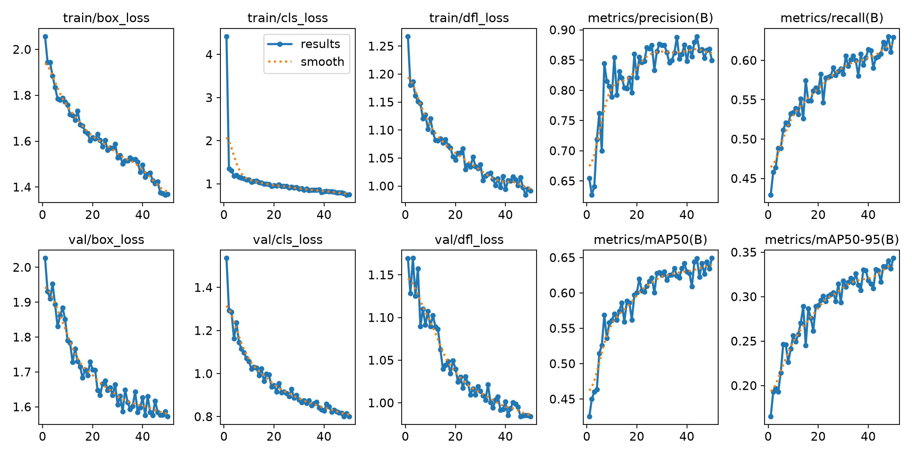

* **No hay sobreajuste:** las pérdidas de validación bajan a la par que las de entrenamiento.
* **El modelo aún estaba aprendiendo:** la mejor época es la última (la 50) y las curvas de mAP y recall siguen subiendo, por lo que con más épocas mejoraría.

### Paso 3 — Evaluación sobre test

Con las 478 imágenes de test, que el modelo no ha visto nunca:

| Métrica | Validación (época 50) | **Test** |
|---|---|---|
| Precisión | 0.850 | **0.878** |
| Recall | 0.629 | **0.597** |
| mAP50 | 0.649 | **0.607** |
| mAP50-95 | 0.343 | **0.312** |
| Tiempo de inferencia | | 14.2 ms por imagen |

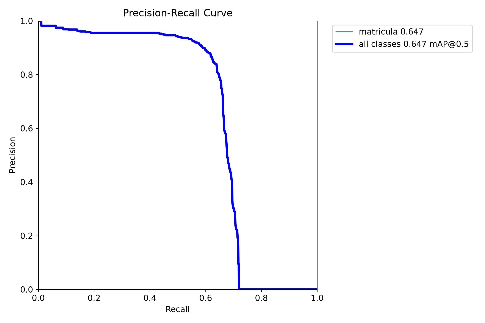 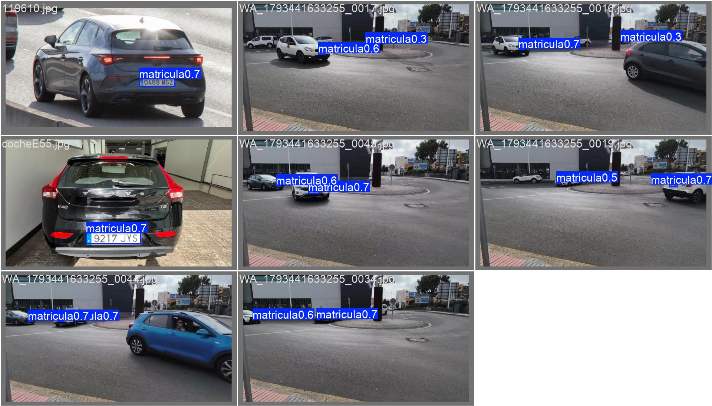

* Test y validación dan valores muy parecidos: el modelo **generaliza bien**.
* La **precisión es alta (0.88)**: cuando detecta una matrícula casi siempre acierta.
* El punto débil es el **recall (0.60)**: se le escapan 4 de cada 10 matrículas. Las que pierde son sobre todo pequeñas y lejanas, que a 640 px ocupan muy pocos píxeles, y muchas de ellas están anotadas como ilegibles.
* El mAP50-95 de 0.31 indica que las cajas no son muy ajustadas, algo poco importante aquí porque solo hay que recortar la matrícula para el OCR.

### Paso 4 — Pipeline sobre el vídeo

El vídeo de test (`videos/C0142.MP4`, 1920×1080, 25 FPS, 2832 fotogramas) muestra una calle con la cámara a ras de suelo y coches que se acercan de frente.

Para cada fotograma:

1. **YOLO11n + TrackTrack** (`model.track(..., persist=True)`, el tracker por defecto de Ultralytics 8.4) detecta y sigue personas, bicicletas, coches, motos, autobuses y camiones, asignando a cada objeto un identificador que se mantiene entre fotogramas.
2. Para cada vehículo de más de 60 px de ancho se **recorta su caja** y se busca la matrícula con el detector entrenado. Todos los recortes del fotograma se pasan al detector de una vez (en lote).
3. Las coordenadas de la matrícula se pasan del recorte al fotograma sumando la esquina del vehículo.
4. Se dibuja todo con un panel de conteo, se escribe el fotograma en el vídeo de salida (reducido a 1280×720) y una fila por objeto en el CSV.

Buscar la matrícula dentro del recorte del vehículo funciona mejor que en el fotograma completo, porque al reescalar el recorte la matrícula ocupa más píxeles. En el primer fotograma, por ejemplo, el detector no encuentra la matrícula del autobús en la imagen completa y sí en su recorte.

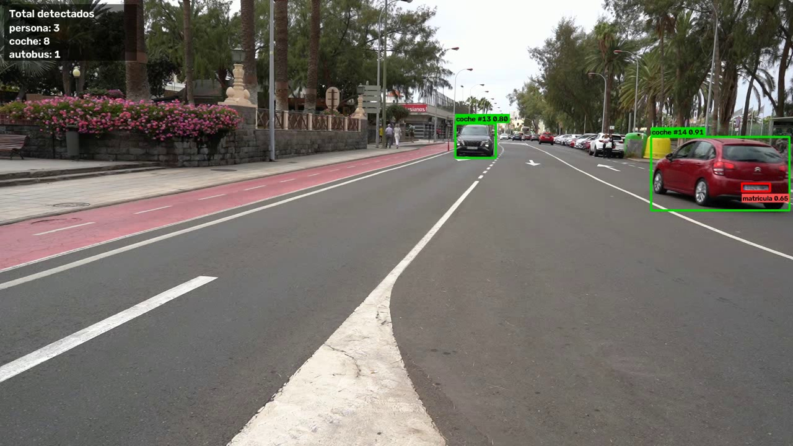 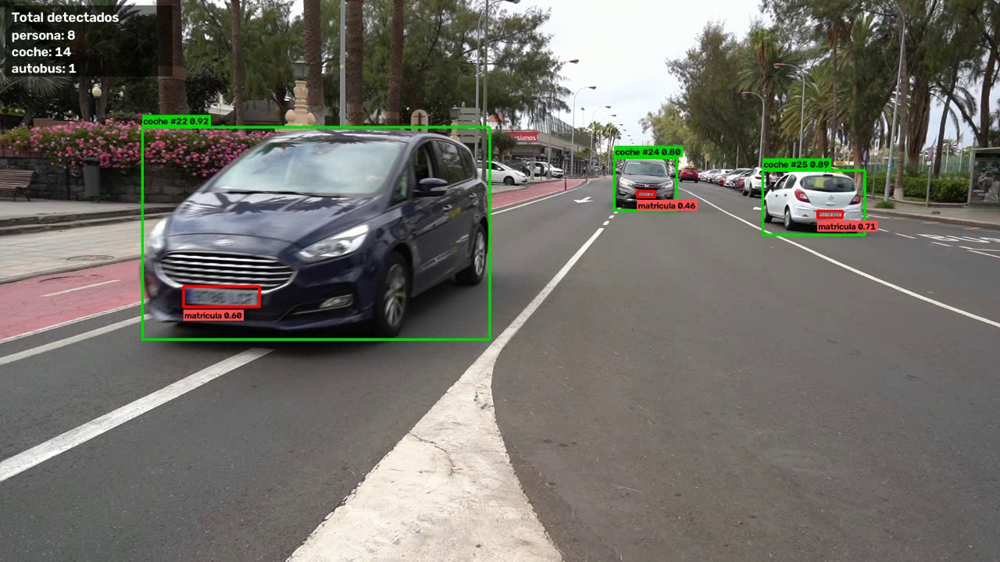

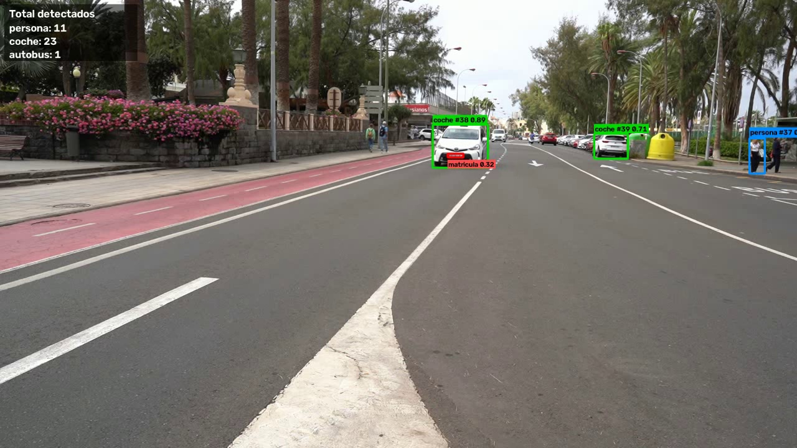 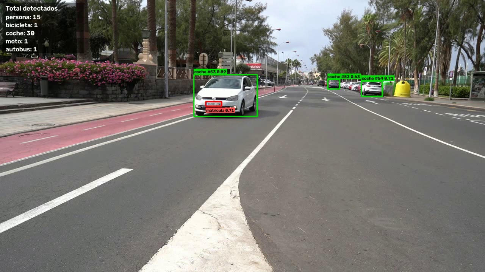

El CSV tiene una fila por objeto y fotograma con el formato propuesto en el enunciado:

```
fotograma, tipo_objeto, confianza, identificador_tracking, x1, y1, x2, y2,
matricula_en_su_caso, confianza_matricula, mx1, my1, mx2, my2, texto_matricula
```

El vídeo se procesa a **4.7 FPS** en una GTX 1050 (unos 10 minutos para todo el vídeo), con 9064 filas en el CSV y 1312 detecciones de matrícula.

### Paso 5 — Conteo de objetos

Se cuentan **identificadores únicos**, no detecciones: un coche aparece en cientos de fotogramas pero tiene un solo identificador. Además:

* La clase de cada objeto es la **mayoritaria** a lo largo de su seguimiento (un coche puede detectarse en algún fotograma como camión).
* Se descartan los seguimientos de menos de 5 fotogramas, que suelen ser detecciones espurias.

| Clase | Objetos únicos |
|---|---|
| Coche | 40 |
| Persona | 16 |
| Bicicleta | 1 |
| Moto | 1 |
| Autobús | 1 |
| Camión | 0 |
| **Total** | **59** |

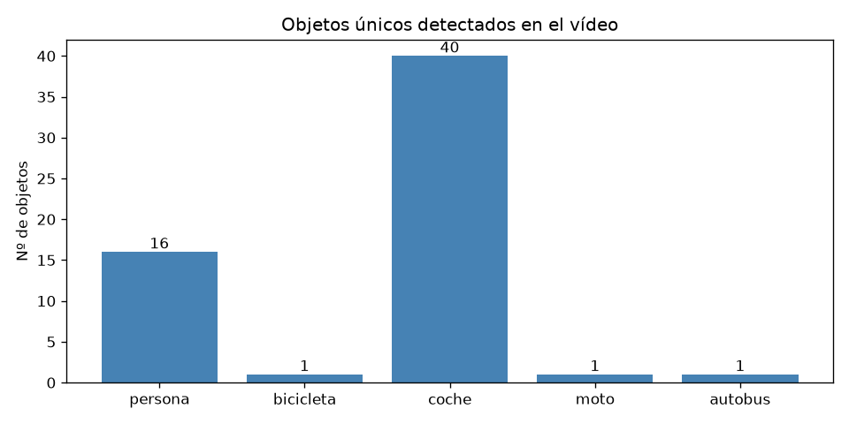

Se detectó la matrícula en algún fotograma en **31 de los 42 vehículos**. Los que no la tienen son sobre todo coches lejanos o aparcados al fondo de la calle.

### Extra — Flujo por dirección

Con la posición del centro de cada objeto en el primer y el último fotograma en que aparece se calcula hacia dónde se mueve (se considera parado si se desplaza menos de 40 px):

| Clase | Hacia la izquierda | Hacia la derecha | Parado |
|---|---|---|---|
| Coche | 29 | 7 | 4 |
| Persona | 3 | 11 | 2 |
| Bicicleta | 1 | 0 | 0 |
| Moto | 1 | 0 | 0 |
| Autobús | 1 | 0 | 0 |

### Técnicas utilizadas

* Preparación del dataset: reparto agrupado para evitar fugas y conversión al formato YOLO.
* *Transfer learning* de YOLO11n para una clase nueva.
* Métricas de detección: precisión, recall, mAP50 y mAP50-95.
* Seguimiento multiobjeto con TrackTrack (CVPR 2025): filtro de Kalman, asociación en dos etapas por confianza y HMIoU.
* Detección en dos etapas: vehículo y matrícula dentro del vehículo.
* Conteo por identificadores únicos con clase mayoritaria.
* Escritura de vídeo con `cv2.VideoWriter` y de resultados en CSV.

---

## Tarea 2 — Reconocimiento de matrículas (OCR)

### Modelos comparados

| Tipo | Modelo | Uso |
|---|---|---|
| OCR clásico | [EasyOCR](https://github.com/JaidedAI/EasyOCR) 1.7.2 | Alfabeto limitado a `A-Z` y `0-9`. Si la matrícula es pequeña, el recorte se amplía a 100 px de alto. Los trozos de texto se unen de izquierda a derecha. |
| VLM | [SmolVLM-256M-Instruct](https://huggingface.co/HuggingFaceTB/SmolVLM-256M-Instruct) | Se le pregunta *"Read the license plate in the image. Answer only with its characters."*, con respuesta de 16 tokens como máximo y sin muestreo. |

Antes de la comparativa se hizo una prueba con distintas configuraciones:

* **SmolVLM-500M** tardaba 12.7 s por matrícula y apenas acertaba más que el de 256M, y el **SmolVLM de 2B** del cuaderno de ejemplo no cabe en una GPU de 3 GB.
* Desactivar el troceado de la imagen de SmolVLM lo hacía más rápido, pero el acierto bajaba del 62 % al 50 % y a veces se inventaba textos largos.
* Ampliar el recorte para EasyOCR mejoraba su acierto con apenas 10 ms más.

### Postprocesado

Los dos modelos cometen errores parecidos, así que se les aplica **el mismo postprocesado**:

1. Mayúsculas y solo letras y números.
2. Si el texto no tiene ya un formato válido (`0000XXX` o el antiguo `GC1234AB`), se busca la ventana de 7 caracteres que puede convertirse en `0000XXX` con **menos sustituciones**, corrigiendo las confusiones típicas según la posición: en la parte numérica `O→0`, `I→1`, `B→8`, `S→5`…, y en la de letras `0→D`, `8→B`, `5→S`…

Esto elimina, por ejemplo, la `E` o la `L` que se leen a veces en la banda azul europea (`L5805MRJ → 5805MRJ`).

### Condiciones del experimento

* **200 matrículas** elegidas al azar (semilla fija) entre las 658 matrículas legibles del split de **test**, que el detector no vio al entrenar.
* **Las mismas imágenes** para los dos modelos, recortadas con la caja anotada más un 5 % de margen, para medir solo la calidad del OCR y no los fallos del detector.
* El texto real se toma de `dataset/ground_truth.csv`.
* El tiempo se mide con `time.perf_counter()` tras 3 llamadas de calentamiento que no se cuentan.

Métricas:

* **Acierto exacto:** porcentaje de matrículas leídas perfectamente.
* **CER (Character Error Rate):** distancia de edición entre el texto leído y el real, dividida por el número de caracteres reales. Es más justa que el acierto exacto, porque fallar un carácter de siete no es un fallo total.

### Resultados

| Modelo | Acierto exacto (sin postprocesado) | **Acierto exacto** | **CER** | Tiempo medio | Tiempo mediano |
|---|---|---|---|---|---|
| EasyOCR | 33.0 % | **42.0 %** | 0.269 | **63 ms** | **49 ms** |
| SmolVLM-256M | 60.5 % | **62.0 %** | **0.161** | 4346 ms | 4424 ms |

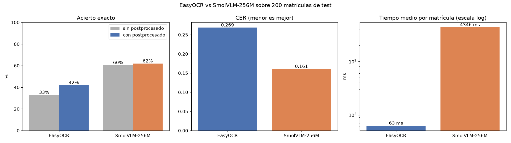

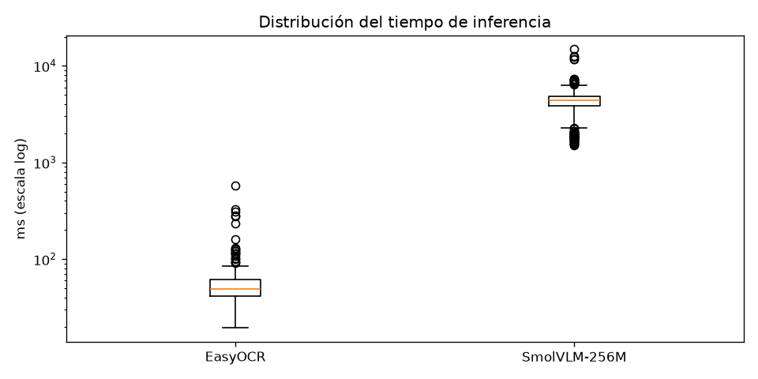

| | Matrículas |
|---|---|
| Aciertan los dos | 71 |
| Solo acierta SmolVLM | 53 |
| Solo acierta EasyOCR | 13 |
| Fallan los dos | 63 |

* **El VLM es más preciso:** acierta un 62 % de las matrículas frente al 42 % de EasyOCR y comete casi la mitad de errores por carácter (CER 0.16 frente a 0.27).
* **EasyOCR es unas 69 veces más rápido:** 63 ms por matrícula frente a 4.3 s. Es el único de los dos que permitiría leer matrículas en tiempo real.
* **El postprocesado ayuda mucho más a EasyOCR** (+9 puntos) que al VLM (+1.5): EasyOCR confunde letras y números parecidos y lee la banda europea, mientras que el VLM ya suele devolver el formato correcto.
* Hay 13 matrículas que solo acierta EasyOCR, por lo que combinar los dos modelos podría mejorar el resultado.
* Los errores comunes a los dos se dan en matrículas pequeñas, borrosas o muy inclinadas.

### OCR en el vídeo

Se parte de las cajas de matrícula del CSV de la Tarea 1 y se usa el VLM, el más preciso. Al revisar los recortes se observó que **la mayoría de las matrículas del vídeo están desenfocadas por el movimiento**: los coches pasan rápido cerca de la cámara y, justo cuando la matrícula se ve más grande, más borrosa está. En una primera versión, que leía las vistas más grandes, el VLM se inventaba matrículas (`1234SGT` aparecía en 9 coches distintos). Por eso el procedimiento final es:

1. Se descartan las detecciones de menos de 40 px de ancho, ilegibles o falsos positivos (quedan 1069 de 1312, en 29 vehículos).
2. Para cada vehículo se eligen sus **5 vistas más nítidas**, medidas con la **varianza del Laplaciano** sobre el recorte reescalado a un ancho fijo.
3. Se leen con SmolVLM y se postprocesan.
4. **Votación:** se elige la lectura fiable con más apoyo, y solo se acepta si al menos otra lectura coincide con ella o difiere en un carácter. Se consideran no fiables las lecturas sin formato válido o con patrones típicos de alucinación del VLM (`0000DDD`, `1234…`).
5. El texto se escribe en la columna `texto_matricula` y se dibuja en el vídeo bajo el vehículo.

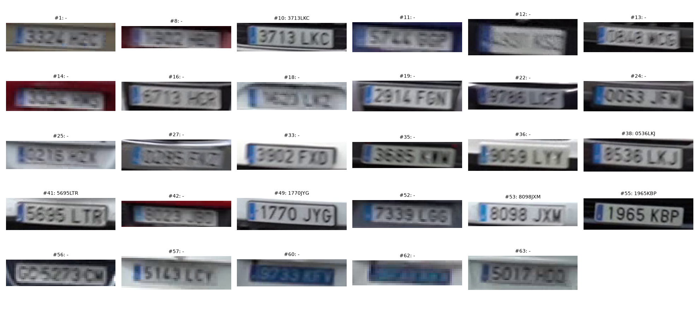

*Vista más nítida de la matrícula de cada vehículo y texto aceptado (`-` si no hubo consenso).*

**Resultado: 6 de 29 vehículos con matrícula leída.** Comparadas con los recortes, **5 son correctas** (`3713LKC`, `5695LTR`, `1770JYG`, `8098JXM` y `1965KBP`) y una (`0536LKJ`, en realidad `8536LKJ`) falla en un carácter. El resto de vehículos queda sin texto: se prefiere no mostrar una matrícula antes que mostrar una inventada.

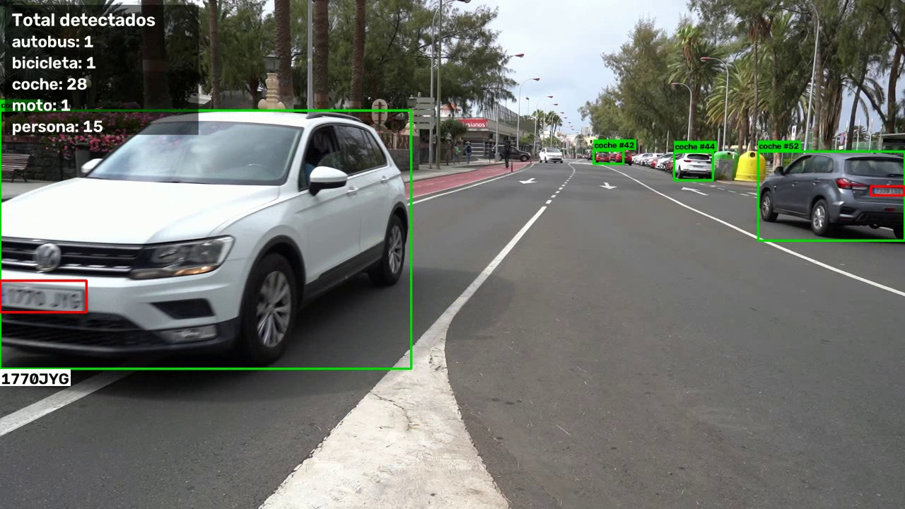 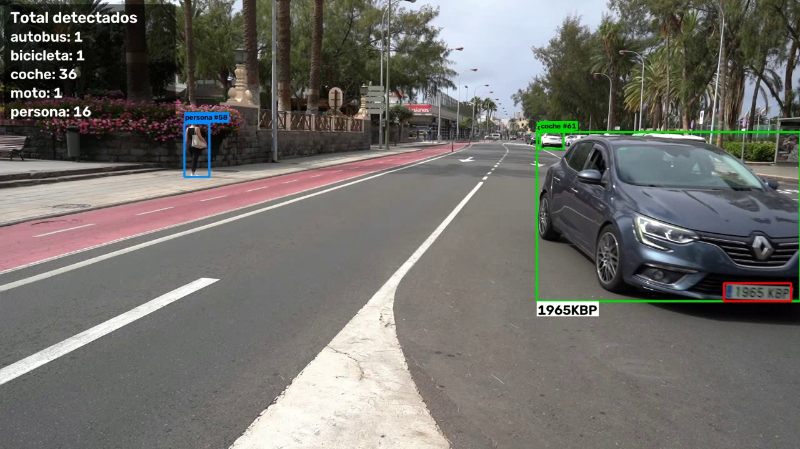

### Técnicas utilizadas

* OCR clásico con EasyOCR y VLM con SmolVLM a través de `transformers`.
* Postprocesado según el formato de matrícula española.
* Métricas de OCR: acierto exacto y CER (distancia de Levenshtein).
* Medición de nitidez con la varianza del Laplaciano.
* Votación entre varias lecturas del mismo vehículo y filtrado de alucinaciones.

### Especificaciones de la máquina

Todos los tiempos se midieron en este equipo:

| Componente | Valor |
|---|---|
| Sistema operativo | Windows 10 (19045) |
| CPU | Intel Core i5-9300H @ 2.40 GHz, 4 núcleos / 8 hilos |
| RAM | 15.8 GB |
| GPU | NVIDIA GeForce GTX 1050 (3 GB) |
| Software | Python 3.12.14, PyTorch 2.6.0 + CUDA 12.4, Ultralytics 8.4.183, EasyOCR 1.7.2, Transformers 5.22.2 |

---

## Cómo ejecutarlo

1. Crear el entorno e instalar las dependencias (ver el [README principal](../README.md#práctica-4)). EasyOCR se instala sin dependencias para que no sustituya `opencv-python` por `opencv-python-headless`, lo que eliminaría `cv2.imshow`:

   ```bash
   pip install ultralytics lap transformers scipy scikit-image python-bidi PyYAML Shapely pyclipper ninja
   pip install --no-deps easyocr
   ```

2. Descargar el dataset en `dataset/` y prepararlo:

   ```bash
   cd dataset
   python preparar_dataset.py unir
   python preparar_dataset.py separar
   ```

3. Descargar el vídeo de test en `videos/` y ejecutar `TAREAS/VC_P4_TAREA_1.ipynb` y después `TAREAS/VC_P4_TAREA_2.ipynb`. El detector ya entrenado se incluye en el repositorio, así que el entrenamiento está desactivado (`ENTRENAR = False`).

---

## Conclusiones

* Con un dataset de unas 2400 imágenes y *transfer learning* sobre YOLO11n se obtiene un detector de matrículas **muy preciso (0.88) pero con recall limitado (0.60)**. Las curvas indican que más épocas o una resolución mayor lo mejorarían.
* Combinar el seguimiento con TrackTrack y la detección de la matrícula **dentro del recorte de cada vehículo** permite contar los objetos del vídeo y localizar la matrícula de 31 de los 42 vehículos.
* En el OCR se cumple el compromiso esperado: el **VLM acierta más (62 % frente a 42 %) pero es unas 69 veces más lento** que el OCR clásico. Un postprocesado basado en el formato de la matrícula mejora a los dos modelos.
* En el vídeo, el factor limitante no es el OCR sino la **calidad de la imagen**: el desenfoque por movimiento hace ilegibles la mayoría de las matrículas. Elegir las vistas más nítidas y exigir consenso entre lecturas evita mostrar matrículas inventadas, a costa de leer solo 6 de 29. Una cámara con menor tiempo de exposición mejoraría mucho este resultado.
