## Práctica 5. Biometría: detección y caracterización de caras

## Descripción

El objetivo es detectar caras, extraer información de ellas (landmarks y expresión) y desarrollar **dos prototipos que reaccionen** a esa información en tiempo real con la webcam.

| Tarea | Prototipo | Qué extrae de la cara | Notebook |
|---|---|---|---|
| Tarea 1 | **Espejo de emociones**: efectos y *skins* según la emoción, con un modo juego *"Imita la emoción"* | **Emoción**, con un modelo **entrenado por nosotros** sobre FER-2013 | [`TAREAS/VC_P5_TAREA_1.ipynb`](TAREAS/VC_P5_TAREA_1.ipynb) |
| Tarea 2 | **¡Transfórmate en Super Saiyan!**: filtro interactivo con niveles de transformación y Kamehameha | **Gestos de la cara y de las manos**, con medidas geométricas entre landmarks | [`TAREAS/VC_P5_TAREA_2.ipynb`](TAREAS/VC_P5_TAREA_2.ipynb) |

El enunciado está en [`ENUNCIADO-P5.md`](ENUNCIADO-P5.md) y los cuadernos de ejemplo de la asignatura en [`ejemplos/`](ejemplos).

### Vídeo de la entrega

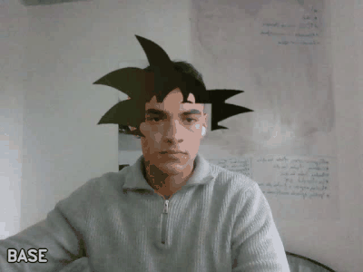

También en vídeo: [`resultados/Pablo/entrega.mp4`](resultados/Pablo/entrega.mp4).

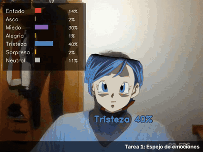

También en vídeo: [`resultados/Roberto/entrega.mp4`](resultados/Roberto/entrega.mp4).

---

## Tarea 1 — Espejo de emociones

### Escenario

Un espejo para la webcam que **reconoce la emoción** de cada cara y **reacciona** con efectos anclados a los landmarks: lágrimas si estás triste, vapor si te enfadas, una imagen superpuesta para cada emoción... Incluye un **modo juego**: el sistema pide una emoción y suma un punto cuando el usuario la mantiene durante un segundo.

Posibles usos: practicar la expresión de emociones (por ejemplo, en terapias con niños), juegos interactivos o *feedback* al ensayar una presentación.

### Paso 1 — Dataset: FER-2013

Se usa **FER-2013** (*Facial Expression Recognition*, reto del ICML 2013), uno de los conjuntos de referencia para reconocer emociones:

* **35 887 caras** en escala de grises de **48×48 píxeles**, ya recortadas y centradas.
* **7 emociones:** enfado, asco, miedo, alegría, tristeza, sorpresa y neutral.
* Se usan sus **particiones oficiales**: *Training* para entrenar, *PublicTest* como validación y *PrivateTest* como test.
* Copia utilizada: [AutumnQiu/fer2013 en HuggingFace](https://huggingface.co/datasets/AutumnQiu/fer2013), en formato parquet. Se descarga en `data/FER2013/` (no se sube al repositorio).

**Por qué este dataset:** es grande, sus caras están recortadas como las que produce un detector y, al ser imágenes de baja resolución tomadas en condiciones reales, se parecen a lo que capta una webcam.

| Emoción | Train | Validación | Test | % train |
|---|---|---|---|---|
| Enfado | 3995 | 467 | 491 | 13.9 % |
| Asco | 436 | 56 | 55 | **1.5 %** |
| Miedo | 4097 | 496 | 528 | 14.3 % |
| Alegría | 7215 | 895 | 879 | **25.1 %** |
| Tristeza | 4830 | 653 | 594 | 16.8 % |
| Sorpresa | 3171 | 415 | 416 | 11.0 % |
| Neutral | 4965 | 607 | 626 | 17.3 % |
| **Total** | **28 709** | **3589** | **3589** | |

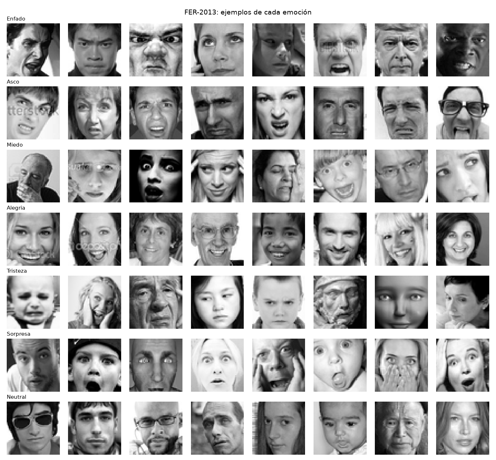

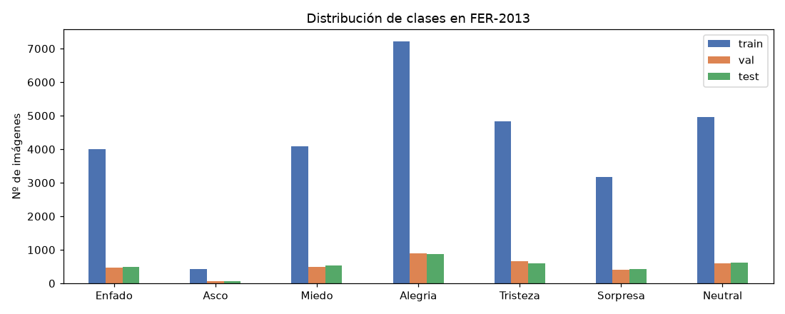

El dataset está muy **desbalanceado**: hay **16.5 veces más caras alegres que de asco**. Para compensarlo, al entrenar se usan **pesos por clase** (los pesos *balanced* suavizados con una raíz cuadrada, para no sobrecompensar *Asco*: va de 0.75 en Alegría a 3.07 en Asco).

La **cara media** de cada emoción ya muestra los rasgos que las distinguen: la boca abierta de la sorpresa, la sonrisa de la alegría o el ceño del enfado.

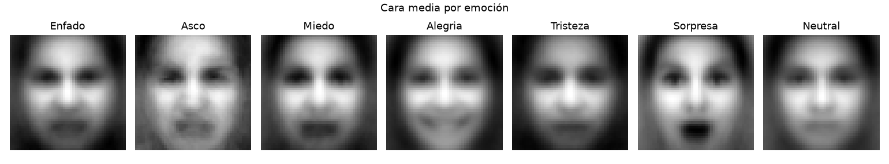

### Paso 2 — Preprocesado de la cara con landmarks

Para que la cara de la webcam llegue al modelo **con el mismo aspecto que las caras de FER-2013**, se usan los **478 landmarks de MediaPipe Face Landmarker**:

1. Se calcula el centro de cada ojo (landmarks 33-133 y 362-263) y el **ángulo** de la línea que los une.
2. Se **rota** la imagen alrededor del punto medio de los ojos para que queden horizontales.
3. Se recorta un **cuadrado** sobre el **óvalo facial** (36 landmarks del contorno) con un 10 % de margen, y se pasa a grises y a 48×48.

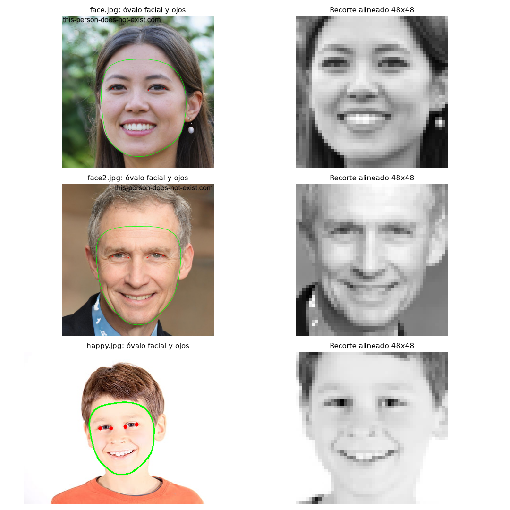

### Paso 3 — Modelo clásico: HOG + LBP + SVM

Cada cara se describe con dos descriptores locales vistos en la práctica:

* **HOG:** celdas de 6×6 píxeles, 9 orientaciones y bloques de 2×2 celdas. Captura la **forma** de cejas, ojos y boca (1764 valores).
* **LBP uniforme** (P=8, R=1) en una rejilla de 4×4 regiones: **textura** local (160 valores).

Las **1924 características** se estandarizan y se clasifican con una **SVM lineal** con pesos por clase. El parámetro `C` se elige con el conjunto de validación según el **F1 macro**:

| C | 0.001 | 0.003 | 0.01 | 0.03 |
|---|---|---|---|---|
| F1 macro (validación) | **0.431** | 0.422 | 0.418 | 0.415 |

### Paso 4 — Red neuronal con *transfer learning*: MobileNetV2

Se parte de **MobileNetV2 preentrenada en ImageNet**, una red ligera pensada para móviles, y se adapta a las emociones:

* **Entrada:** la cara de 48×48 en grises se amplía a 96×96, se replica en 3 canales y se normaliza a [-1, 1], como espera la red.
* ***Data augmentation*** (solo al entrenar): volteo horizontal, rotación, zoom y traslación.
* **Cabeza nueva:** *Global Average Pooling* → Dropout 0.3 → Dense 128 (ReLU) → Dropout 0.3 → Dense 7 (softmax).
* 2.4 M de parámetros en total.

El entrenamiento se hace en **dos fases**:

1. **Cabeza** (5 épocas): la red base **congelada**, solo se entrenan las capas nuevas (165 000 parámetros), con tasa de aprendizaje 1e-3.
2. ***Fine-tuning*:** se **descongelan las 38 últimas capas** de MobileNetV2 (desde `block_13`) y se entrena con una tasa 10 veces menor (1e-4). La **parada temprana** detuvo el entrenamiento en la época 13 y recuperó los pesos de la mejor, la **10** (accuracy de validación 0.515).

Tiempo total: **22 minutos en CPU** (TensorFlow no usa la GPU en Windows).

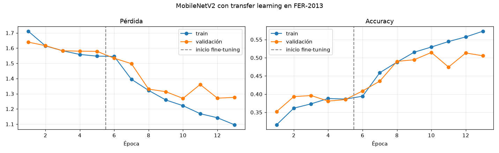

* En la fase 1, con la red congelada, la accuracy de validación se queda en torno al 0.40: las características de ImageNet no bastan para distinguir emociones.
* Al empezar el ***fine-tuning*** (línea discontinua) sube de golpe hasta 0.49-0.51, porque la red adapta sus capas profundas a las caras.
* En las últimas épocas la accuracy de entrenamiento sigue subiendo (0.57) mientras la de validación se estanca: el modelo empieza a **sobreajustar**, y por eso la parada temprana corta y recupera la época 10.

### Paso 5 — Evaluación sobre test

Resultados sobre las 3589 caras de **test**, no usadas ni para entrenar ni para elegir hiperparámetros:

| Modelo | Accuracy | F1 macro | F1 ponderado |
|---|---|---|---|
| HOG + LBP + SVM | 0.474 | 0.426 | 0.459 |
| **MobileNetV2 (transfer learning)** | **0.528** | **0.454** | **0.497** |

F1 por emoción:

| Emoción | HOG + LBP + SVM | MobileNetV2 |
|---|---|---|
| Enfado | 0.341 | **0.436** |
| Asco | **0.320** | 0.298 |
| Miedo | **0.296** | 0.188 |
| Alegría | 0.666 | **0.751** |
| Tristeza | **0.324** | 0.304 |
| Sorpresa | 0.578 | **0.673** |
| Neutral | 0.457 | **0.531** |

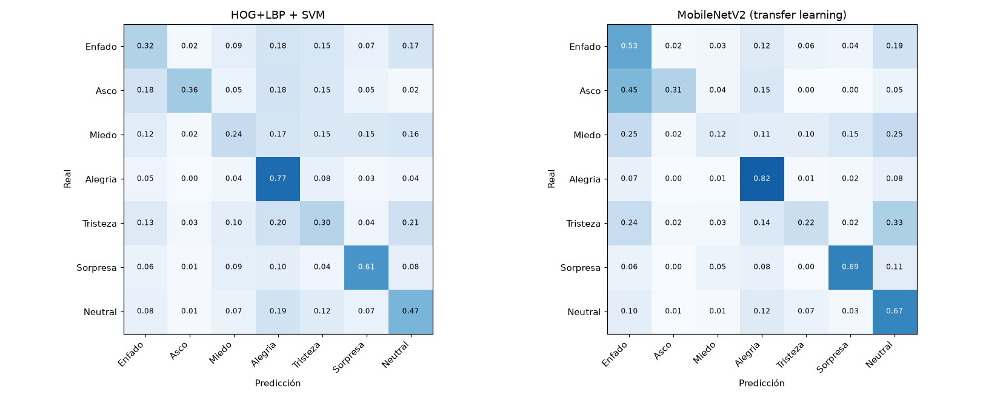

* **La red es mejor en conjunto** (+5.4 puntos de accuracy y +2.8 de F1 macro) y en las emociones más marcadas: alegría, sorpresa, neutral y enfado.
* **Las dos fallan en las mismas emociones:** miedo, tristeza y asco. Miedo se confunde con sorpresa y tristeza, y tristeza con neutral. La red apenas reconoce el miedo (**recall de 0.12**).
* Estos valores son razonables para FER-2013: la **precisión humana** en este dataset se estima en torno al 65 %, por la ambigüedad de muchas expresiones y las etiquetas ruidosas.

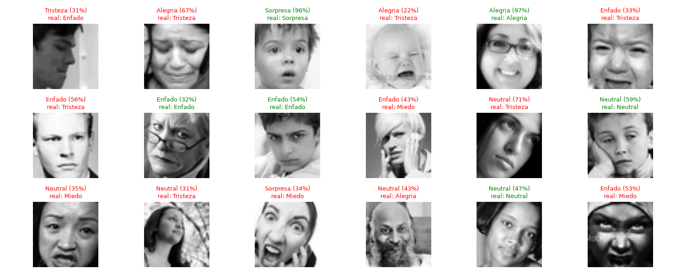

### Paso 6 (extra) — Comparativa entre el modelo clásico y la red

| | HOG + LBP + SVM | MobileNetV2 |
|---|---|---|
| Accuracy (test) | 0.474 | **0.528** |
| F1 macro (test) | 0.426 | **0.454** |
| Tiempo de entrenamiento | **3 min** (+ 2 min de extracción de características y ~15 min eligiendo C) | 22 min |
| Inferencia por cara | **3.9 ms** | 8.5 ms |
| Tamaño del modelo | **0.16 MB** | 25.1 MB |
| Facilidad de uso | Hay que diseñar los descriptores (HOG, LBP, celdas...) | Aprende las características sola, pero necesita más datos y tiempo de entrenamiento |

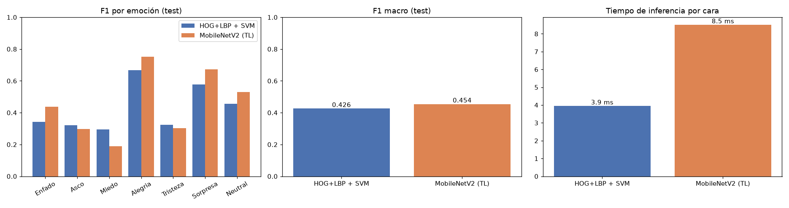

El modelo clásico es **más rápido y unas 160 veces más pequeño**, pero la red **acierta más**. Los dos son lo bastante rápidos para la webcam (menos de 10 ms por cara), así que el prototipo usa la red.

### Paso 7 (extra) — Comparativa con `DeepFace.analyze`

Sobre las **mismas 500 caras de test**:

| Modelo | Accuracy | F1 macro | Inferencia por cara |
|---|---|---|---|
| `DeepFace.analyze` | 0.526 | **0.532** | 16.7 ms |
| HOG + LBP + SVM | 0.498 | 0.433 | **3.9 ms** |
| **MobileNetV2 (nuestro)** | **0.530** | 0.437 | 8.5 ms |

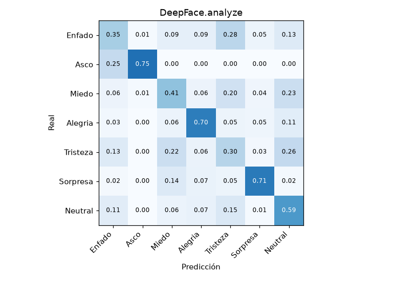

* Nuestra red **iguala la accuracy** de deepface y es el **doble de rápida**.
* Deepface tiene **mejor F1 macro**: reparte mejor los aciertos entre las emociones minoritarias.
* Hay que tener en cuenta que **el modelo de deepface también se entrenó con FER-2013**, así que juega en casa.

### Paso 8 — Calibración de las probabilidades

Al probar el prototipo con la webcam, el modelo casi nunca detectaba **miedo** ni **asco**, como anticipaba su bajo recall en test. Para compensarlo sin reentrenar, la probabilidad de cada emoción **se multiplica por un factor** y se renormaliza.

Los factores no se eligen a mano: se buscan automáticamente con el **conjunto de validación**, clase a clase, quedándose con los que maximizan el **F1 macro**. El test no se usa, para no contaminar la evaluación.

| Enfado | Asco | Miedo | Alegría | Tristeza | Sorpresa | Neutral |
|---|---|---|---|---|---|---|
| 0.8 | 1.0 | **1.8** | **0.6** | **1.5** | 1.0 | 0.8 |

**El F1 macro en validación sube de 0.451 a 0.491.** Se reduce el peso de alegría, la emoción que el modelo ya reconoce mejor, y se aumenta el de miedo y tristeza. La contrapartida es que aumentan los falsos positivos de estas clases y algunas sonrisas suaves pueden confundirse con otras emociones. Los factores se guardan en [`modelos/calibracion_emociones.json`](modelos/calibracion_emociones.json).

### Paso 9 — Prototipo con la webcam

Para cada fotograma:

1. **MediaPipe Face Landmarker** (modo `VIDEO`) detecta hasta 2 caras y sus 478 landmarks.
2. Cada cara se **alinea y recorta** como en el paso 2 y todas se clasifican en un solo lote.
3. Se aplica la **calibración** y un **suavizado temporal** (media móvil exponencial de las probabilidades), para que los efectos no parpadeen entre fotogramas.
4. Si la emoción ganadora supera el 40 % de probabilidad, se lanza su reacción.

**Reacciones**, ancladas a los landmarks y escaladas con la distancia entre los ojos para que funcionen a cualquier distancia de la cámara:

* ***Skins*:** una imagen PNG con transparencia para cada emoción, en [`img/recursos/`](img/recursos), como los filtros de las redes sociales. Puede ser de **pelo**, apoyado en la frente (landmark 10), o de **cara completa**, centrado entre la frente y la barbilla (landmark 152). Se **escala** con el ancho de la cara (landmarks 234-454) y se **gira** con la inclinación de los ojos, para que siga a la cabeza.
* **Animaciones** (si una emoción no tiene *skin*): rubor y destellos con la alegría, lágrimas que caen de los párpados con la tristeza, vapor con el enfado, exclamaciones con la sorpresa, temblor con el miedo y tinte verde con el asco.
* **Panel** con la probabilidad de cada emoción.
* **Modo juego *"Imita la emoción"*:** pide una emoción al azar (entre alegría, sorpresa, enfado, tristeza y neutral, las que el modelo reconoce mejor) y suma un punto si se mantiene un segundo, con un límite de 10 segundos por ronda.

| Tecla | Acción |
|---|---|
| `j` | Activa o desactiva el modo juego |
| `m` | Muestra u oculta la malla de landmarks |
| `g` | Graba un clip para el vídeo de la entrega |
| `Esc` | Salir |

**Prueba con imágenes fijas:**

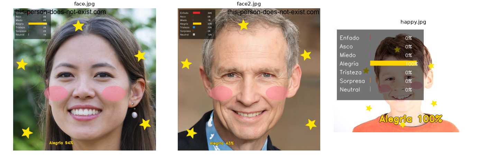

`face.jpg` y `happy.jpg` se clasifican bien como alegría (89 % y 100 %). En `face2.jpg` el modelo predice enfado (37 %), con alegría muy cerca en segundo lugar (32 %): la sonrisa es suave y con la boca cerrada, mientras que en FER-2013 la mayoría de caras alegres enseñan los dientes. Además, el modelo asocia las arrugas del entrecejo al enfado, y las personas mayores están poco representadas en el dataset. La calibración, que reduce el peso de la alegría, acentúa este caso.

### Técnicas utilizadas

* Detección de caras y 478 landmarks con MediaPipe Face Landmarker.
* Alineado de la cara con los landmarks de los ojos.
* Descriptores HOG y LBP con SVM lineal.
* *Transfer learning* de MobileNetV2 en dos fases, con *data augmentation*, pesos por clase y parada temprana.
* Métricas: accuracy, F1 macro y ponderado, y matrices de confusión.
* Calibración de probabilidades con el conjunto de validación.
* Suavizado temporal, *skins* PNG con canal alfa y efectos anclados a landmarks.

---

## Tarea 2 — ¡Transfórmate en Super Saiyan!

### Escenario

Un **filtro interactivo** para la webcam inspirado en Dragon Ball, que reacciona a la **expresión de la cara** y a la **postura de las manos**. No usa ningún modelo entrenado: todo se decide con **medidas geométricas entre landmarks** de la cara y las manos.

Posibles usos: filtro para redes sociales o videollamadas, juego de gestos o demostrador de detección de expresiones y manos en tiempo real.

| Nivel | Cómo se activa | Reacción |
|---|---|---|
| **0. Base** | Cara normal | Pelo negro |
| **1. Super Saiyan** | **Cara de enfado**: cejas bajas y juntas | Pelo dorado y aura dorada |
| **2. Transformación** | Enfado **+ los dos puños cerrados bajo la barbilla** | Rayos eléctricos, temblor de imagen, aura más intensa y barra de poder |
| **3. Kamehameha** | **Manos juntas y abiertas** para cargar, y **abrir mucho la boca** (el grito) para disparar | Bola de energía que crece y rayo hacia un lado o hacia la cámara |

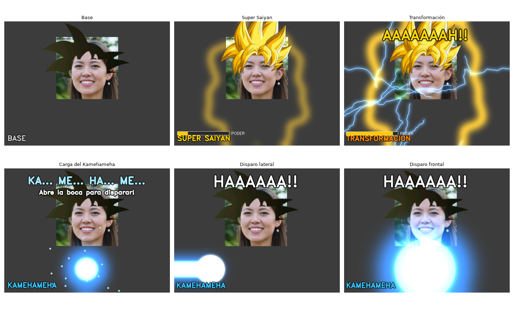

### Paso 1 — Detección y landmarks

Se usan dos *tasks* de **MediaPipe**: **Face Landmarker** (478 puntos de una cara) y **Hand Landmarker** (21 puntos por mano, hasta dos manos), en modo `VIDEO`, que sigue los puntos de forma más estable entre fotogramas.

| Medida | Landmarks | Normalizada por | Para qué |
|---|---|---|---|
| Altura de las cejas | centro de la ceja (105, 334) → párpado superior (159, 386) | distancia entre ojos | Enfado: las cejas bajan |
| Separación de las cejas | extremos interiores (107, 336) | distancia entre ojos | Enfado: las cejas se juntan |
| Apertura de la boca | labio superior (13) → inferior (14) | alto de la cara (10 → 152) | Grito para disparar |
| Puño cerrado | puntas de los dedos (8, 12, 16, 20) → muñeca (0) | tamaño de la palma (0 → 9) | Puños de la transformación |
| Manos juntas | centro de cada mano (0, 5, 9, 13, 17) | tamaño medio de la palma | Carga del Kamehameha |
| Colocación del pelo | frente (10), barbilla (152), ojos y laterales (234, 454) | ancho de la cara | Pelo base y Super Saiyan |

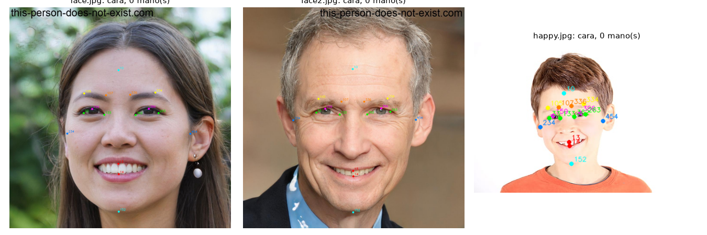

Al dividir cada distancia por una medida de la propia cara o mano, los valores **no cambian al acercarse o alejarse de la cámara**.

### Paso 2 — Calibración y señales

Cada persona tiene unas cejas y una boca distintas, así que al empezar se piden **2 segundos de cara neutra** y se guarda la **mediana** de cada medida. El enfado y el grito se miden como **cambio respecto a esa referencia**, lo que es mucho más robusto que un umbral fijo. Con la tecla `c` se repite la calibración.

En cada fotograma se calculan cuatro señales:

* **Ira** = 0.65 × (caída relativa de la altura de las cejas) + 0.35 × (caída relativa de su separación).
* **Grito** = apertura de la boca − apertura neutra.
* **Puños abajo** = número de puños cerrados (*dedos/palma* < 1.35) por debajo de la barbilla.
* **Manos juntas** = dos manos abiertas a menos de 1.8 palmas de distancia.

### Paso 3 — Máquina de estados con histéresis

Las señales de un solo fotograma oscilan, así que no se cambia de nivel directamente con ellas:

* La **ira** se suaviza con una media móvil y usa **dos umbrales**: 0.10 para entrar en enfado y 0.06 para salir. Así no se entra y se sale continuamente al estar cerca del límite.
* Cada condición solo se activa si se cumple **4 fotogramas seguidos** y solo se desactiva tras **8 fotogramas** sin cumplirse.
* **Prioridad:** Kamehameha > Transformación > Super Saiyan > Base.
* **Kamehameha:** con las manos juntas la carga sube de 0 a 1 en 2 segundos. Con al menos la mitad de carga, un grito dispara el rayo durante 2 segundos. Si la bola está a un lado de la cara el rayo sale horizontal hacia ese lado, y si está delante sale **hacia la cámara**.

### Paso 4 — Efectos

* **Pelo:** PNG anclados a la frente, escalados con el ancho de la cara y girados con la inclinación de los ojos.
* **Brillo:** las luces se dibujan en una capa negra, se difuminan con un filtro gaussiano y se **suman** al fotograma, como una luz real.
* **Aura:** contorno ondulado alrededor de la cabeza y los hombros, con llamas que crecen con el poder.
* **Rayos:** zigzags generados por **desplazamiento del punto medio** desde los bordes de la pantalla hacia el cuerpo.
* **Temblor** de toda la imagen en la transformación y en el disparo.
* **Textos:** "KA... ME... HA... ME..." según la carga y "HAAAAAA!!" al disparar.

| Tecla | Acción |
|---|---|
| `d` | Modo *debug*: landmarks usados y barras de cada señal con su umbral |
| `c` | Repite la calibración de la cara neutra |
| `g` | Graba un clip para el vídeo de la entrega |
| `Esc` | Salir |

### Técnicas utilizadas

* Landmarks de la cara y de las manos con MediaPipe.
* Medidas geométricas normalizadas, invariantes a la distancia.
* Calibración por usuario con la mediana de la cara neutra.
* Máquina de estados con histéresis y suavizado temporal.
* Superposición de PNG con canal alfa, rotación y escalado.
* Efectos de luz con desenfoque gaussiano y mezcla aditiva.

---

## Cómo ejecutarlo

1. Crear el entorno `VC_P5` del enunciado y añadir `pyarrow` (para leer FER-2013). Ojo: MediaPipe y deepface instalan **OpenCV 5**, que ya no lee los modelos Caffe del detector DNN de los ejemplos. Hay que dejar OpenCV en 4.12:

   ```bash
   pip install pyarrow
   pip uninstall -y opencv-python opencv-contrib-python opencv-contrib-python-headless
   pip install opencv-contrib-python-headless==4.12.0.88
   pip install --force-reinstall --no-deps opencv-contrib-python==4.12.0.88
   ```

2. Descargar FER-2013 en `data/FER2013/` (`train.parquet`, `valid.parquet` y `test.parquet` del [repositorio de HuggingFace](https://huggingface.co/datasets/AutumnQiu/fer2013/tree/main/data)).
3. **Tarea 1:** ejecutar el notebook. El entrenamiento de la red tarda unos 22 minutos en CPU. Una vez guardado el modelo, `ENTRENAR_CNN = False` lo carga sin reentrenar, y para usar solo el prototipo basta con las celdas indicadas al principio de la Parte 3.
4. **Tarea 2:** no necesita dataset. Basta con los modelos de MediaPipe que hay en `modelos/`.

Los modelos entrenados están en [`modelos/`](modelos): `emociones_mobilenetv2.keras`, `emociones_hog_lbp_svm.joblib` y `calibracion_emociones.json`.

### Especificaciones de la máquina

| Componente | Valor |
|---|---|
| CPU | Intel Core i5-9300H @ 2.40 GHz, 4 núcleos / 8 hilos |
| RAM | 15.8 GB |
| GPU | NVIDIA GeForce GTX 1050 (3 GB), **no usada**: TensorFlow no admite GPU en Windows nativo |
| Software | Python 3.11, TensorFlow 2.21, Keras 3.15, MediaPipe 1.2.3, OpenCV 4.12, scikit-learn 1.9, deepface 0.0.105 |

---

## Conclusiones

* Para reconocer emociones, el ***transfer learning*** con MobileNetV2 supera al modelo clásico HOG + LBP + SVM (accuracy 0.53 frente a 0.47 en test) y es lo bastante rápido para tiempo real en CPU (8.5 ms por cara). El modelo clásico sigue siendo una alternativa válida si importan el tamaño (0.16 MB) o la velocidad.
* El principal límite no es el modelo sino el **dataset**: FER-2013 está muy desbalanceado y algunas emociones son ambiguas incluso para las personas. Las dos aproximaciones fallan en miedo, tristeza y asco. La **calibración con validación** mejora el equilibrio entre emociones (F1 macro de 0.45 a 0.49) sin reentrenar.
* Nuestra red alcanza la accuracy del modelo de emociones de deepface sobre las mismas caras, siendo el doble de rápida.
* Los **landmarks** son la base de los dos prototipos: sirven para alinear la cara antes de clasificarla, para anclar y girar los efectos con la cabeza y, en la Tarea 2, para reconocer gestos **sin ningún modelo entrenado**, solo con distancias normalizadas.
* La **robustez** en tiempo real no depende solo de la precisión del modelo: el suavizado temporal, la histéresis y la calibración a cada usuario son lo que evita que los efectos parpadeen y hace que los prototipos respondan de forma estable.
